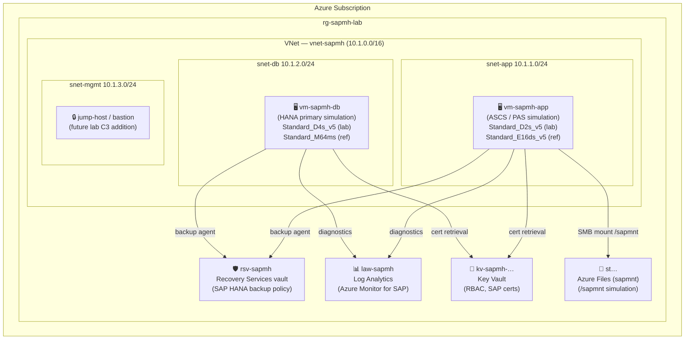

# Infrastructure (Bicep / Azure Verified Modules)

Bicep IaC for the **simulated SAP landing zone** the labs deploy. We use
[Azure Verified Modules (AVM)](https://aka.ms/avm) where possible for quality and supportability.

> A real SAP system is **not** deployed. These templates stand up the **Azure** landing zone,
> networking and management plane around a _simulated_ SAP landscape.

---

## Topology



Each subnet has a dedicated **Network Security Group** enforcing SAP-specific port rules
(HANA MDC: 30013/30015/30040-42; SAP GUI: 3200; HSR: 40000-40002; SSH restricted to mgmt subnet).

---

## Layout

```text
infra/
  main.bicep              Subscription-scoped entry point (creates RG + calls all modules)
  bicepconfig.json        Bicep linter rules (secure-* and outputs-should-not-contain-secrets = error)
  modules/
    network.bicep         VNet + 3 NSGs (AVM avm/res/network/*)
    compute.bicep         2x Linux VMs representing app + HANA tiers (AVM avm/res/compute/virtual-machine)
    storage.bicep         Azure Files storage simulating /sapmnt (AVM avm/res/storage/storage-account)
    monitoring.bicep      Log Analytics workspace for Azure Monitor for SAP (AVM avm/res/operational-insights/workspace)
    backup.bicep          Recovery Services vault + SAP HANA backup policy (AVM avm/res/recovery-services/vault)
    keyvault.bicep        Key Vault with RBAC (AVM avm/res/key-vault/vault)
  params/
    lab.bicepparam        Classroom deployment — cheap SKUs (~$2–5 USD/hr)
    reference.bicepparam  Reference topology — SAP-certified SKUs (document/show-and-tell only)
tests/
  infra/
    validate.ps1          Static validation script (runs without az login)
```

---

## Sizing profiles

| Resource            | `lab` (classroom)     | `reference` (show-and-tell)  |
|---------------------|-----------------------|------------------------------|
| App VM              | Standard_D2s_v5       | Standard_E16ds_v5            |
| DB VM (HANA)        | Standard_D4s_v5       | Standard_M64ms               |
| Storage             | Standard_LRS          | Premium_ZRS                  |
| Log retention       | 30 days               | 90 days                      |
| KV purge protection | ❌ disabled           | ✅ enabled                   |
| KV soft delete      | 7 days                | 90 days                      |

### Estimated lab cost (Sweden Central, 2024)

| Component                        | SKU / config                  | Approx. cost  |
|----------------------------------|-------------------------------|---------------|
| App VM (vm-sapmh-app)            | Standard_D2s_v5, 1 instance   | ~$0.10/hr     |
| DB VM (vm-sapmh-db)              | Standard_D4s_v5, 1 instance   | ~$0.19/hr     |
| Azure Files storage              | Standard_LRS, 100 GiB         | ~$0.01/hr     |
| Log Analytics workspace          | PerGB2018, 30-day retention   | ~$0.01/hr     |
| Recovery Services vault          | Backup storage < 1 GiB        | ~$0.00/hr     |
| Key Vault                        | Standard, low ops             | ~$0.00/hr     |
| **Total (lab profile)**          |                               | **~$0.31/hr** |

> 💡 A typical 4-hour class session costs approximately **$1.25 USD** for the lab profile.
> Always run `az deployment sub what-if` before deploying and **delete the resource group when done**.

---

## AVM module versions

| Module                                          | Version |
|-------------------------------------------------|---------|
| `avm/res/network/network-security-group`        | 0.5.3   |
| `avm/res/network/virtual-network`               | 0.9.0   |
| `avm/res/storage/storage-account`               | 0.32.1  |
| `avm/res/operational-insights/workspace`        | 0.15.1  |
| `avm/res/recovery-services/vault`               | 0.11.3  |
| `avm/res/key-vault/vault`                       | 0.13.3  |
| `avm/res/compute/virtual-machine`               | 0.22.2  |

---

## Validate (no deployment required)

```bash
# Static build — runs without az login
az bicep build --file infra/main.bicep
az bicep lint  --file infra/main.bicep

# Full validation suite (build + params + secret scan + cost guardrails)
pwsh tests/infra/validate.ps1
```

---

## Deploy (requires `az login`)

### 1. Login and set subscription

```bash
az login
az account set --subscription "<YOUR_SUBSCRIPTION_ID>"
```

### 2. Preview with what-if (recommended)

```bash
# Lab profile — safe for classroom
az deployment sub what-if \
  --location swedencentral \
  --template-file infra/main.bicep \
  --parameters @infra/params/lab.bicepparam \
  --parameters adminSshPublicKey="$(cat ~/.ssh/id_rsa.pub)"

# Reference profile — SAP-certified topology for documentation purposes
az deployment sub what-if \
  --location swedencentral \
  --template-file infra/main.bicep \
  --parameters @infra/params/reference.bicepparam \
  --parameters adminSshPublicKey="$(cat ~/.ssh/id_rsa.pub)"
```

### 3. Deploy

```bash
az deployment sub create \
  --location swedencentral \
  --template-file infra/main.bicep \
  --parameters @infra/params/lab.bicepparam \
  --parameters adminSshPublicKey="$(cat ~/.ssh/id_rsa.pub)" \
  --name deploy-sapmh-lab-$(date +%Y%m%d)
```

### 4. Connect to a VM (after deployment)

```bash
# Get the VM's private IP (use Bastion or a jump host for production)
az vm show -g rg-sapmh-lab -n vm-sapmh-app --show-details --query privateIps -o tsv

# SSH (from within the VNet or via Azure Bastion)
ssh azureuser@<PRIVATE_IP>
```

### 5. Clean up

```bash
# Delete the resource group to stop all billing
az group delete --name rg-sapmh-lab --yes --no-wait
```

---

## Production vs. lab differences

| Concern                    | Lab (simulated)                     | Production / Reference                                  |
|----------------------------|-------------------------------------|---------------------------------------------------------|
| Shared file system (/sapmnt)| Azure Files Standard_LRS           | Azure NetApp Files Premium, NFS v4.1                   |
| VM OS                      | Ubuntu 22.04 LTS Gen2               | SLES 15 SP5 for SAP or RHEL 8.x for SAP               |
| VM sizing (app)            | Standard_D2s_v5                     | Standard_E16ds_v5 or larger                            |
| VM sizing (HANA)           | Standard_D4s_v5                     | Standard_M64ms+ (SAP-certified, HANA TDI)              |
| HA / clustering            | None (single VM)                    | Pacemaker + SBD, ASCS/ERS cluster, HSR secondary       |
| Availability Zones         | -1 (no zone pinning)                | Zone 1+2 pinned (AZ-aware deployment)                  |
| ExpressRoute               | Not included                        | Required for production connectivity                    |
| ACSS (Azure Center for SAP)| Not configured                      | Recommended for lifecycle management                   |

---

## Links

- [SAP on Azure Architecture Guide — Microsoft Learn](https://learn.microsoft.com/azure/sap/workloads/get-started)
- [Azure Center for SAP Solutions (ACSS)](https://learn.microsoft.com/azure/sap/center-sap-solutions/overview)
- [Azure Monitor for SAP Solutions](https://learn.microsoft.com/azure/sap/monitor/about-azure-monitor-sap-solutions)
- [SAP HANA on Azure VMs — deployment guide](https://learn.microsoft.com/azure/sap/workloads/hana-vm-operations-storage)
- [Azure Verified Modules catalog](https://aka.ms/avm)
- [Module B.1.1 — Implementation Capability (specialization)](https://github.com/NikoMix/specialization-sap-on-azure)

