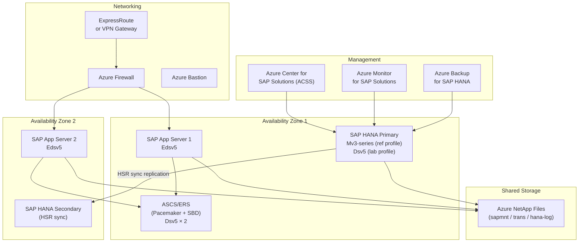

import { Aside, Steps, Badge, Card, CardGrid, LinkCard } from "@astrojs/starlight/components";

export const base = import.meta.env.BASE_URL;

<Badge text="Module B.1.1" variant="note" /> <Badge text="Azure-technical" variant="tip" />
<Badge text="~75 min" variant="default" />

## Learning objectives

By the end of this lab you can:

- Deploy an Azure **landing zone for a simulated SAP landscape** using the Bicep modules in
  `infra/`, choosing **lab** (inexpensive) vs **reference** (M-series) sizing profiles.
- Explain the SAP-on-Azure service surface the auditor expects: M/Mv3 VMs, Azure NetApp Files,
  Availability Zones, ExpressRoute, ACSS, HSR, and ASCS/ERS clustering.
- Use the **Module B Lab Coach** Copilot agent with the `draft-case-study` skill to produce a
  **case study**, an **architecture diagram**, and a **capability statement** as B.1.1 evidence.
- File evidence artefacts using the Advanced Specialization naming convention
  `[ControlRef]_[DocumentType]_v[N].pdf`.

---

## Background — B.1.1 control at a glance

Control **B.1.1** asks partners to demonstrate **proven implementation capability** for SAP on
Azure. Auditors look for:

| Evidence type                | Accepted artefact                                                                    |
| ---------------------------- | ------------------------------------------------------------------------------------ |
| Customer engagement proof    | Case study (anonymised) with customer name, project scope, and outcome               |
| Technical architecture       | Architecture diagram showing Azure services, HANA tier, ASCS/ERS, ANF                |
| Partner capability statement | Partner-authored narrative mapping their practice to the specialization requirements |
| Deployment evidence          | Portal or CLI screenshots, ARM/Bicep deployment logs, ACSS registration              |

This lab produces all four using Bicep (static validation) and GitHub Copilot skills.

---

## Reference architecture

The diagram below shows the target topology you will deploy (lab profile) and reference in your
evidence artefacts.



:::note[Trainer notes]
**Timing:** 5 min scene-setting + architecture walkthrough. Ask the room: _"Which services do you
already know? Which are new?"_ The Mv3 / ANF pairing typically gets the most questions — link to
the [SAP on Azure Architecture reference](/reference/sap-on-azure-architecture/).

**Talk track:** stress that lab profile uses cheap Dsv5 VMs (no M-series quota needed) but the
Bicep code and evidence narrative still reference M/Mv3 as the reference sizing — exactly what the
auditor validates.
:::

---

## Step 1 — Validate the Bicep landing zone

Open your Codespace (from C0) and confirm you are signed in to Azure.

```bash
az account show -o table
```

### 1a · Compile-check the Bicep

```bash
az bicep build --file infra/main.bicep
```

You should see no errors. This confirms the Bicep compiles cleanly — in CI this is all that runs
(no live deployment needed for the specialization audit artefact).

### 1b · Review the sizing profiles

Open `infra/main.bicep` and `infra/params/lab.bicepparam` in the editor. Key parameters:

| Parameter       | lab profile     | reference profile     | What it controls                         |
| --------------- | --------------- | --------------------- | ---------------------------------------- |
| `sizingProfile` | `lab`           | `reference`           | VM SKU and ANF tier selection            |
| `workloadName`  | `sapmh`         | your choice           | Resource-name prefix                     |
| `location`      | `swedencentral` | any AZ-capable region | Must support ANF for `reference` profile |

### 1c · (Optional) Run a what-if against your subscription

If you have an Azure subscription and Owner access, run a dry-run deployment to see exactly what
would be created — no resources are actually deployed:

```bash
az deployment sub what-if \
  --location swedencentral \
  --template-file infra/main.bicep \
  --parameters infra/params/lab.bicepparam
```

Expected output: a table of resource changes showing one resource group (`rg-sapmh-lab`) to create.

:::note[Trainer notes]
**Timing:** 10 min. Most SAP Basis consultants have little Bicep experience — walk them through the
`targetScope = 'subscription'` concept and explain how AVM modules layer on top. It is fine if the
what-if step is skipped (quota or permissions issues are common in classroom environments).

**Pitfall:** the `az deployment sub what-if` command requires Contributor or Owner on the
subscription scope. Remind pupils to use their **own** sandbox subscription.
:::

---

## Step 2 — Map services to the B.1.1 audit checklist

Use the reference architecture and the table below to annotate which Azure services satisfy each
audit dimension the auditor reviews under B.1.1.

| B.1.1 audit dimension               | Azure service(s) in scope                                      |
| ----------------------------------- | -------------------------------------------------------------- |
| SAP-certified HANA compute          | M-series / Mv2 / Mv3 VMs (HANA TDI certified)                  |
| High availability (HANA tier)       | HSR sync replication across Availability Zones                 |
| High availability (app / ASCS tier) | Pacemaker + SBD on Dsv5, ASCS/ERS clustering                   |
| Shared storage (SAP global FS)      | Azure NetApp Files (NFS 4.1, `/sapmnt`, `/usr/trans`)          |
| Network connectivity                | ExpressRoute (primary) or VPN Gateway + Azure Firewall         |
| Management & operations             | ACSS, Azure Monitor for SAP solutions, Azure Backup for HANA   |
| Security / identity                 | Microsoft Entra ID SAML SSO for Fiori, PIM for Basis elevation |

Take 3 minutes and annotate which services your lab-profile deployment would spin up vs. which
only appear in the `reference` profile (you'll use this mapping in Step 4).

---

## Step 3 — Open the Module B Lab Coach agent

In GitHub Copilot Chat (VS Code or the web), invoke the Module B Lab Coach:

```
@moduleb-lab-coach /help
```

The agent responds with its capabilities. It knows the Module B controls, the SAP-on-Azure service
surface, and the evidence-naming convention.

<Aside type="tip">
  If the agent isn't available, make sure the devcontainer has loaded the agent definition from
  `.github/agents/`. See the [Copilot Agents, Skills & MCP](
  {`${base}reference/copilot-agents-skills-mcp/`}) reference page.
</Aside>

---

## Step 4 — Draft the B.1.1 case study

Use the `draft-case-study` skill. Paste the prompt below into Copilot Chat (with the agent active):

```
@moduleb-lab-coach #draft-case-study
Context:
  - Partner: [YOUR COMPANY NAME]
  - Customer: ACME Manufacturing GmbH (anonymised)
  - Scope: SAP S/4HANA 2023 greenfield on Azure, 2 × AZ, Mv3 HANA, ANF, ASCS/ERS
  - Azure region: Sweden Central (AZ 1 & 2)
  - Project duration: 14 weeks
  - Outcome: Production go-live achieved; < 2 s HANA query p99 latency post-migration
Control: B.1.1
```

Review the generated case study. It should include:

- Partner name and role
- Customer name (anonymised) and industry
- SAP workload scope (system and release)
- Azure services deployed (matching B.1.1 surface)
- Project outcome with measurable results
- Date of deployment

:::note[Trainer notes]
**Timing:** 10 min. Let students use their **own** (fictional or anonymised real) engagement
details. The point is to practise the evidence-generation workflow, not to produce a publishable
case study.

**Common gap:** students forget to include measurable outcomes. Prompt them: "What p99 latency did
HANA achieve? What was the RTO target?"
:::

---

## Step 5 — Generate the architecture diagram

Ask the Lab Coach to produce a Mermaid architecture diagram aligned to your deployment:

```
@moduleb-lab-coach #draft-case-study
Generate a Mermaid architecture diagram for a SAP S/4HANA on Azure deployment with:
- 2 Availability Zones (Sweden Central)
- SAP HANA Mv3 primary (AZ1) + HSR secondary (AZ2)
- ASCS/ERS Pacemaker cluster (Dsv5 × 2 across zones)
- 2 × Edsv5 Application Servers
- Azure NetApp Files for shared storage
- ExpressRoute + Azure Firewall
- ACSS, Azure Monitor for SAP, Azure Backup
Format as a Mermaid flowchart suitable for a B.1.1 evidence document.
```

Copy the generated Mermaid block into a new Markdown file as your diagram evidence.

---

## Step 6 — Draft the capability statement

Use the Lab Coach to produce the final B.1.1 piece — the partner capability statement:

```
@moduleb-lab-coach #draft-case-study
Draft a B.1.1 partner capability statement for [YOUR COMPANY NAME].
Include:
- Number of completed SAP on Azure S/4HANA deployments in the last 24 months
- Azure regions the practice has operated in
- Team certifications (AZ-120 SAP on Azure, SAP HANA certified architects)
- Practice specializations (greenfield, cloud migration, RISE)
- Reference to the ACME Manufacturing case study
Keep it under 500 words; formal, third-person.
```

Adjust the generated text to reflect your actual company details before using it as evidence.

:::note[Trainer notes]
**Timing:** 10 min. This is often the step partners find hardest — they struggle to articulate
practice scale in audit-friendly language. The Copilot-generated draft gives them a strong starting
point to edit rather than face a blank page.
:::

---

## Step 7 — File the evidence artefacts

Rename and organise the three artefacts following the specialization naming convention:

| Artefact             | File name example                | Folder              |
| -------------------- | -------------------------------- | ------------------- |
| Case study           | `B11_CaseStudy_v1.pdf`           | `Module B / B1.1 /` |
| Architecture diagram | `B11_ArchitectureDiagram_v1.pdf` | `Module B / B1.1 /` |
| Capability statement | `B11_CapabilityStatement_v1.pdf` | `Module B / B1.1 /` |

**Convention:** `[ControlRef]_[DocumentType]_v[N].pdf` — increment `vN` on each revision.

<Aside type="caution">
  Remove or anonymise all real customer names before submitting to the specialization audit portal.
  The sample "ACME Manufacturing GmbH" name is a placeholder.
</Aside>

---

## Verification checklist

Run the verification script to confirm the lab outputs are present:

```bash
bash labs/challenge-1-implementation/verify.sh
```

or on PowerShell:

```powershell
pwsh labs/challenge-1-implementation/verify.ps1
```

Manual checks:

- [ ] `az bicep build --file infra/main.bicep` exits 0
- [ ] Three evidence files created and named `B11_*_v1.*`
- [ ] Case study includes a measurable outcome (latency, RTO, etc.)
- [ ] Architecture diagram includes both Availability Zones
- [ ] Capability statement is under 500 words and references a real engagement

---

:::note[Trainer notes]
**Total timing:** 75 minutes.

| Step | Activity                      | Time   |
| ---- | ----------------------------- | ------ |
| 0    | C0 recap, scene-setting       | 5 min  |
| 1    | Bicep compile + what-if       | 10 min |
| 2    | Service mapping exercise      | 10 min |
| 3    | Load Lab Coach agent          | 5 min  |
| 4    | `draft-case-study` + review   | 15 min |
| 5    | Architecture diagram          | 10 min |
| 6    | Capability statement          | 10 min |
| 7    | File artefacts + verification | 10 min |

**Pitfalls:**

- If `az bicep build` fails with "bicep not found", run `az bicep install` first.
- Some pupils will want to deploy live — redirect them to the `what-if` path; live deployment takes 20+ min and diverts focus.
- The Lab Coach skill names (`draft-case-study`, `generate-hld`) reference the prompt files in `.github/prompts/`. Confirm they're loaded in the devcontainer before class.

**Answer key:** see `labs/challenge-1-implementation/sample-answers/` for reference outputs.
:::
