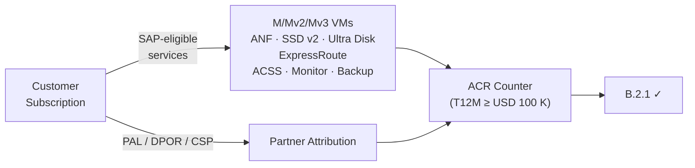

import { Aside, Steps, Badge } from "@astrojs/starlight/components";

<Badge text="Module B.2.1" variant="note" /> <Badge text="Copilot + Azure MCP" variant="tip" />
<Badge text="~60 min" variant="default" />

## What is ACR and why B.2.1 matters

**Azure Consumed Revenue (ACR)** is the billable Azure spend associated with a partner via one of
three attribution mechanisms: **PAL** (Partner Admin Link), **DPOR** (Digital Partner of Record), or
**CSP** (Cloud Solution Provider direct billing). Control **B.2.1** requires partners to prove a
minimum ACR threshold — typically **USD 100,000 trailing 12 months (T12M)** — drawn specifically
from the **SAP-eligible service set**. Generic Azure spend on services outside that set does
**not** count.



### SAP-eligible service set

Only spend in these Azure service families counts towards the B.2.1 threshold.

| Service                               | Azure family                    | SAP role                           |
| ------------------------------------- | ------------------------------- | ---------------------------------- |
| M8ms – M960ixs (M-series)             | Virtual Machines                | App server, HANA scale-up          |
| Mv2-64ms – Mv2-416ms                  | Virtual Machines                | Large HANA scale-up / scale-out    |
| Mv3-64ms – Mv3-176s                   | Virtual Machines                | Next-gen HANA certified            |
| Azure NetApp Files (ANF)              | Storage                         | HANA data/log volumes (NFS 4.1)    |
| Premium SSD v2                        | Storage                         | HANA persistent storage            |
| Ultra Disk                            | Storage                         | HANA storage alternative           |
| Azure ExpressRoute                    | Networking                      | SAP-to-on-premises connectivity    |
| Azure Center for SAP solutions (ACSS) | SAP management                  | Managed SAP lifecycle              |
| Azure Monitor for SAP solutions       | Monitoring                      | HANA DB, OS, application telemetry |
| Azure Backup for SAP HANA             | Backup                          | Backint-certified HANA backups     |
| ASCS/ERS cluster infra (VMs + LB)     | Virtual Machines, Load Balancer | HA SAP cluster                     |

:::note[Trainer notes]
**Talk track (5 min before the lab):** "B.2.1 is a revenue-credibility gate. Auditors verify two
things: _is attribution in place?_ (PAL/DPOR/CSP) and _are the services SAP-eligible?_ A
subscription with USD 2 M of general Azure spend but zero M-series VMs or ANF does **not**
pass B.2.1."

**Common pitfall:** trainees confuse _total subscription ACR_ with _SAP-eligible ACR_. Show the
raw Cost Management export side-by-side with the annotated view before Copilot runs.
:::

## Prerequisites

- [ ] C0 environment setup complete — Azure CLI authenticated, Azure MCP server active in Copilot Chat.
- [ ] Sandbox subscription has at least one month of spend **or** use the sample data under
      `labs/challenge-3-acr/sample-data/`.
- [ ] PAL is **not yet set** on the sandbox subscription (you will add it in Step 5).

## Learning objectives

By the end of this lab you can:

1. Use the **Azure MCP server** from Copilot to query trailing-3-month consumption without leaving
   the IDE.
2. Identify and isolate SAP-on-Azure-eligible spend and produce an **annotated breakdown**.
3. Build a **trend table** showing monthly SAP-eligible ACR growth toward the B.2.1 threshold.
4. Set up **PAL** on a subscription and explain when PAL attribution gaps occur.
5. Produce the `B21_ACRBreakdown_v1.pdf` evidence artefact in the correct naming convention.

## Lab

<Steps>

1.  ### Inspect the sample consumption data

    The sample CSV shipped in this repo mimics a real Cost Management monthly export:

    ```bash
    head -6 labs/challenge-3-acr/sample-data/consumption-by-service.csv
    ```

    You should see columns: `BillingMonth`, `SubscriptionId`, `ServiceName`, `ServiceFamily`,
    `MeterCategory`, `Cost`, `Currency`. Three months of mixed SAP and non-SAP spend for a
    fictitious subscription `sub-contoso-sap-prod` are included.

2.  ### Query live consumption via the Azure MCP server

    Open **Copilot Chat** (`Ctrl+Shift+I`) and address the **Module B Lab Coach** agent:

    ```
    @lab-coach Use the Azure MCP server to pull my trailing-3-month consumption for
    subscription ${AZURE_SUBSCRIPTION_ID}, grouped by ServiceName. Show results as a
    markdown table with columns: ServiceName | Total Cost USD | % of Total.
    ```

    If you are using the provided sample data instead of a live subscription:

    ```
    @lab-coach Read labs/challenge-3-acr/sample-data/consumption-by-service.csv and
    summarise total cost per ServiceName across all three months. Format as a markdown table.
    ```

    <Aside type="tip">
      The Azure MCP server must be listed in Copilot's active MCP servers panel. If it does not
      appear, reopen the Codespace and check the devcontainer's `.mcp.json`.
    </Aside>

3.  ### Annotate SAP-eligible spend with the `annotate-acr` skill

    Still in Copilot Chat, invoke the skill:

    ```
    @lab-coach Run the annotate-acr skill on the consumption table above. For each row mark it
    SAP-ELIGIBLE or NON-ELIGIBLE using the B.2.1 service list, then output:
    1. The annotated table
    2. The SAP-eligible subtotal and its percentage of total spend
    3. An annualised SAP-eligible ACR estimate vs the USD 100,000 threshold
    ```

    The `annotate-acr` skill is defined in `.github/prompts/annotate-acr.prompt.md` (built in the
    AI-tooling workstream). Expected output (values will differ if using live data):

    | ServiceName                 | 3-month Cost (USD) | SAP Eligible           |
    | --------------------------- | ------------------ | ---------------------- |
    | Virtual Machines — M-series | 42,500             | ✅ YES                 |
    | Azure NetApp Files          | 8,200              | ✅ YES                 |
    | ExpressRoute                | 1,800              | ✅ YES                 |
    | Azure Backup                | 620                | ✅ YES                 |
    | App Service                 | 340                | ❌ NO                  |
    | **SAP-eligible total**      | **53,120**         | ≈ USD 212 K annualised |

    :::note[Trainer notes]
    **Answer key:** annualised ≈ USD 212 K → comfortably above the USD 100 K threshold. If the
    total is below threshold, check the CSV path and that the subscription has M-series VMs or ANF.
    :::

4.  ### Build the monthly ACR trend table

    Ask Copilot to break down the ACR by billing month:

    ```
    @lab-coach Using the same data, produce a monthly breakdown of SAP-eligible ACR showing
    Jan/Feb/Mar 2026 and whether each month is on track for the USD 100K T12M threshold
    (≥ USD 8,333 per month average). Add a Δ column showing month-on-month change.
    ```

    Save the output to the evidence folder:

    ```bash
    mkdir -p labs/challenge-3-acr/evidence
    # Copy Copilot's markdown output and save it
    echo "# B.2.1 — ACR Trend" > labs/challenge-3-acr/evidence/B21_ACRBreakdown_v1.md
    echo "<!-- Paste Copilot's annotated table + trend here -->" \
      >> labs/challenge-3-acr/evidence/B21_ACRBreakdown_v1.md
    ```

5.  ### Set up PAL on the sandbox subscription

    **PAL (Partner Admin Link)** associates a partner's MPN ID with a subscription so that
    consumption is credited back to the partner's ACR counter. It is the fastest remediation when
    a customer subscription is under-attributed.

    **Via Azure Portal:**

    1. Sign in to [portal.azure.com](https://portal.azure.com) with a user who has **Owner** or
       **Contributor** role on the subscription.
    2. Go to **All Services → Management + governance → Partner Admin Link**.
    3. Select **+ Add** and enter your **MPN ID** (Microsoft Partner Network ID).
    4. Click **Link**. Attribution reflects in Partner Center within 24 hours.

    **Via Azure CLI:**

    ```bash
    az managementpartner create --partner-id <YOUR_MPN_ID>
    az managementpartner show
    ```

    :::note[Trainer notes]
    **Timing:** 5 min. PAL is per-user per-subscription. A common mistake is linking PAL via a
    service-principal that is removed — ACR stops accruing. Best practice: link via a dedicated
    "lighthouse" user account that stays active throughout the engagement.

    **Sovereign clouds:** PAL for Azure Government, Azure China, and Azure Germany does **not**
    contribute to commercial-cloud B.2.1 ACR. Raise this if trainees have government customers.
    :::

6.  ### Verify and package the evidence artefact

    ```bash
    # Confirm the evidence file was created
    ls -lh labs/challenge-3-acr/evidence/

    # Quick sanity check: the file should reference SAP-eligible services
    grep -i "NetApp\|M-series\|ExpressRoute\|Backup" \
      labs/challenge-3-acr/evidence/B21_ACRBreakdown_v1.md
    ```

    In a real submission, convert the markdown to PDF and rename it
    `B21_ACRBreakdown_v1.pdf` before uploading to the evidence pack in C6.

</Steps>

## Verification checklist

- [ ] Annotated consumption table produced — SAP-eligible vs non-eligible clearly split.
- [ ] Monthly trend table shows 3 months of SAP-eligible ACR.
- [ ] Annualised SAP-eligible ACR estimate exceeds the USD 100 K T12M threshold (sample data).
- [ ] `az managementpartner show` returns your MPN ID on the sandbox subscription.
- [ ] Evidence file `B21_ACRBreakdown_v1.md` saved in `labs/challenge-3-acr/evidence/`.

## Evidence produced

| Artefact                                | Naming convention         | Control satisfied |
| --------------------------------------- | ------------------------- | ----------------- |
| ACR annotated breakdown + monthly trend | `B21_ACRBreakdown_v1.pdf` | B.2.1             |

:::note[Trainer notes]
**Full talk track and slide deck** live in the [Facilitation Guide](/trainer-guide/facilitation/)
and `slides/`. For re-delivery: if the room already has PAL in place, skip Step 5 and focus on
the Copilot annotation flow and threshold calculation — those are the exam-relevant skills.
:::
