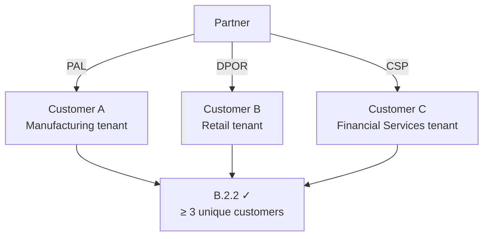

import { Aside, Steps, Badge, Tabs, TabItem } from "@astrojs/starlight/components";

<Badge text="Module B.2.2" variant="note" /> <Badge text="Copilot skill" variant="tip" />
<Badge text="~45 min" variant="default" />

## What B.2.2 requires

Control **B.2.2** validates that a partner manages **three or more unique SAP customers** on
Microsoft Azure, each with a valid attribution link. "Unique" means distinct Azure tenants or
subscriptions — one large customer split into many subscriptions still counts as one unless the
subscriptions span separate billing tenants.



### Attribution types at a glance

| Type     | Full name                 | How it works                                         | Notes                                       |
| -------- | ------------------------- | ---------------------------------------------------- | ------------------------------------------- |
| **PAL**  | Partner Admin Link        | Partner user gets Owner/Contributor and links MPN ID | Fastest to set up; gov subs excluded        |
| **DPOR** | Digital Partner of Record | Nominated in Azure Marketplace / Cloud Marketplace   | Usually set by customer or CSP admin        |
| **CSP**  | Cloud Solution Provider   | Partner is direct CSP reseller for the subscription  | Counted via Partner Center transaction data |

:::note[Trainer notes]
**Talk track (3 min before lab):** "B.2.2 is the _who do you serve?_ gate. Three customers,
three different organisations. Auditors cross-check each entry back to a case study or DPOR
record. Copilot's `build-customer-crossref` skill does that cross-check automatically."

**Common pitfalls:**

- Government/sovereign subscriptions attributed via PAL may not qualify (region-dependent).
- DPOR records older than 24 months may be stale — check Partner Center for expiry.
- Listing the same tenant three times under different subscription names is **not** three customers.
  :::

## Prerequisites

- [ ] C3 complete — you have the `consumption-by-service.csv` and `consumption-by-customer.csv`
      exports (or use the sample data in `labs/challenge-4-customer-diversity/sample-data/`).
- [ ] You can identify the attribution type (PAL/DPOR/CSP) for each customer in the sample data.

## Learning objectives

By the end of this lab you can:

1. Explain the three attribution types and identify which applies to each customer.
2. Use the `build-customer-crossref` skill to turn a By-Customer consumption export into an
   **anonymised customer list** and a **cross-reference table**.
3. Link each customer to a B.1.1 case study and a B.3.1 skilling holder.
4. Identify and remediate ineligible attribution cases.

## Background: the By-Customer view

The sample JSON (`labs/challenge-4-customer-diversity/sample-data/customers.json`) represents three
customers with their attribution evidence. In a real scenario this data comes from:

- **Partner Center → Customers** (for CSP customers).
- **Cost Management → Scope → Management Group** (for PAL/DPOR, aggregate view).
- **Azure Lighthouse** delegated tenants (for multi-tenant managed service scenarios).

The sample models three customers:

| Customer alias        | Industry           | Attribution | SAP systems                               |
| --------------------- | ------------------ | ----------- | ----------------------------------------- |
| Contoso Manufacturing | Manufacturing      | PAL         | ECC 6.0 on Mv2, ANF                       |
| Fabrikam Retail       | Retail             | DPOR        | S/4HANA Cloud Private Edition on M-series |
| Northwind Finance     | Financial Services | CSP         | BW/4HANA on Premium SSD v2                |

## Lab

<Steps>

1. ### Review the By-Customer sample data

   ```bash
   cat labs/challenge-4-customer-diversity/sample-data/customers.json | python3 -m json.tool | head -60
   ```

   Each entry contains: `customerId` (anonymised), `alias`, `industry`, `attributionType`,
   `mpnId`, `subscriptionId`, `sapSystems`, and `b11CaseStudyRef`. Confirm that all three
   customers have a valid attribution type.

2. ### Build the customer list and cross-reference table

   Open **Copilot Chat** and run the `build-customer-crossref` skill:

   ```
   @moduleb-lab-coach Run the build-customer-crossref skill on labs/challenge-4-customer-diversity/
   sample-data/customers.json. Produce:
   1. An anonymised customer list table (alias, industry, attribution type, SAP systems)
   2. A cross-reference table linking each customer to their B.1.1 case study ref and
      B.3.1 skilling holder
   3. A flag for any customers whose attribution may be ineligible
   ```

   The skill reads the JSON, validates attribution types against the B.2.2 rules, and generates
   both tables. Save the output:

   ```bash
   mkdir -p labs/challenge-4-customer-diversity/evidence
   echo "# B.2.2 — Customer Diversity Evidence" \
     > labs/challenge-4-customer-diversity/evidence/B22_CustomerList_v1.md
   echo "<!-- Paste Copilot's customer list + cross-reference here -->" \
     >> labs/challenge-4-customer-diversity/evidence/B22_CustomerList_v1.md
   ```

3. ### Verify attribution eligibility

   For each customer, confirm the attribution is eligible:

   <Tabs>
     <TabItem label="PAL — Portal check">
       1. Sign in to [portal.azure.com](https://portal.azure.com). 2. Navigate to **All Services →
       Partner Admin Link**. 3. Confirm your MPN ID is linked to the subscription.
     </TabItem>
     <TabItem label="DPOR — Partner Center">
       1. Sign in to [partner.microsoft.com](https://partner.microsoft.com). 2. Navigate to
       **Customers → [customer name] → Subscriptions**. 3. Confirm "Digital Partner of Record" shows
       your MPN ID.
     </TabItem>
     <TabItem label="CSP — Partner Center">
       1. Sign in to Partner Center. 2. Navigate to **Customers → [customer name]**. 3. Confirm the
       customer is under your CSP account and the subscription is active.
     </TabItem>
   </Tabs>

   :::note[Trainer notes]
   **Answer key:** in the sample data, all three customers have valid, distinct attribution types
   (PAL, DPOR, CSP). If a trainee flags "Northwind Finance" as potentially ineligible, explore
   why: CSP is fully eligible for commercial Azure; only sovereign-cloud government subs differ.
   :::

4. ### Cross-reference to B.1.1 case studies

   The `build-customer-crossref` skill links each customer back to the case study produced in C1.
   Check the `b11CaseStudyRef` field in the JSON for each customer. In Copilot Chat:

   ```
   @moduleb-lab-coach For each customer in the list, confirm whether a B.1.1 case study file
   exists at the referenced path (e.g. labs/challenge-1-implementation/evidence/). Flag
   any missing case studies as a gap to resolve before C6 audit readiness.
   ```

5. ### Identify and fix ineligible cases (discussion exercise)

   Ask Copilot to explain a remediation scenario:

   ```
   @moduleb-lab-coach Customer "Northwind Finance" has their PAL set via a service principal that was
   deleted 3 months ago. What is the impact on B.2.2 and what are the remediation steps?
   ```

   Expected Copilot response: PAL attribution stops accruing the moment the linked user/SP loses
   access. Remediation = re-link PAL via an active user account and request a Partner Center
   data refresh (takes 24–48 h).

</Steps>

## Verification checklist

- [ ] Three customers identified in the sample data, each with a distinct attribution type.
- [ ] Customer list table produced (anonymised, industry, attribution, SAP systems).
- [ ] Cross-reference table links each customer to a B.1.1 case study ref.
- [ ] No ineligible attribution flags remain unresolved.
- [ ] Evidence file `B22_CustomerList_v1.md` saved in `labs/challenge-4-customer-diversity/evidence/`.

## Evidence produced

| Artefact                                               | Naming convention         | Control satisfied |
| ------------------------------------------------------ | ------------------------- | ----------------- |
| Anonymised customer list + attribution cross-reference | `B22_CustomerList_v1.pdf` | B.2.2             |

:::note[Trainer notes]
**Full talk track and slide deck** live in the [Facilitation Guide](/trainer-guide/facilitation/)
and `slides/`. For re-delivery: if the audience only has CSP customers, adapt Step 3 to focus
on the Partner Center CSP tab — the PAL/DPOR tabs can be shown quickly for contrast.
:::
