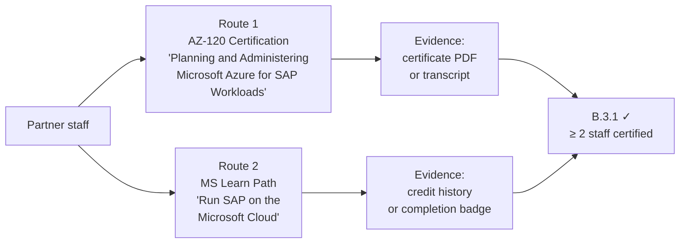

import { Aside, Steps, Badge, Tabs, TabItem } from "@astrojs/starlight/components";

<Badge text="Module B.3.1" variant="note" /> <Badge text="Copilot skill" variant="tip" />
<Badge text="~45 min" variant="default" />

## What B.3.1 requires

Control **B.3.1** validates that partner personnel have completed SAP-on-Azure training. At least
**two individuals** must satisfy one of the two eligible routes:



### Route comparison

|                           | AZ-120                                  | Run SAP on the Microsoft Cloud (MS Learn) |
| ------------------------- | --------------------------------------- | ----------------------------------------- |
| **Depth**                 | Full exam certification                 | Self-paced learning path (~8 h)           |
| **Validity**              | 1 year (free online renewal assessment) | No expiry (badge issued on completion)    |
| **Cost**                  | ~USD 165 exam fee                       | Free                                      |
| **Audience**              | SAP Basis + Azure admins                | SAP + Azure newcomers                     |
| **Evidence type**         | Cert transcript PDF                     | MS Learn profile export / badge           |
| **Recommended for B.3.1** | Highest credibility ✅                  | Accepted, fastest route ✅                |

:::note[Trainer notes]
**Talk track (3 min before lab):** "B.3.1 is the _skills gate_. Two individuals must be certified
or complete the learning path. AZ-120 carries more weight in a competitive specialization audit
but either route is accepted. Copilot's `build-skilling-plan` skill maps your team automatically
and flags gaps."

**Tip for SAP Basis audience:** most trainees already have the SAP knowledge but are newer to
Azure. Point them to the 'SAP on Azure administration' module in the MS Learn path as the fastest
way to fill that gap without sitting the full AZ-120 exam.
:::

## Prerequisites

- [ ] C0 environment complete.
- [ ] Access to `labs/challenge-5-skilling/sample-data/team-skilling.csv` (provided) **or** a real
      team roster with certification status.
- [ ] (Optional) Access to [Microsoft Learn profile](https://learn.microsoft.com/en-us/users) to
      confirm completion data.

## Learning objectives

By the end of this lab you can:

1. Compare AZ-120 and the "Run SAP on the Microsoft Cloud" learning path for B.3.1 eligibility.
2. Use the `build-skilling-plan` skill to generate a **skilling mapping table** from a team CSV.
3. Produce a per-person Microsoft Learn study plan for team members with gaps.
4. Identify and resolve stale certifications (AZ-120 past its 1-year validity).
5. Produce the `B31_SkillingMapping_v1.pdf` evidence artefact.

## AZ-120 module overview

The AZ-120 exam covers:

| Domain                                                | Weight |
| ----------------------------------------------------- | ------ |
| Plan and deploy SAP workloads on Azure                | 20–25% |
| Design and implement storage, networking, and compute | 25–30% |
| Configure SAP HANA, NetWeaver, and S/4HANA            | 25–30% |
| Monitor, maintain, and migrate SAP workloads          | 15–20% |

Study resources (all free):

- [AZ-120 Microsoft Learn path](https://learn.microsoft.com/en-us/credentials/certifications/azure-for-sap-workloads-specialty/)
- [SAP on Azure practitioner guide](https://learn.microsoft.com/en-us/azure/sap/workloads/get-started)
- [SAP HANA on Azure operations guide](https://learn.microsoft.com/en-us/azure/sap/large-instances/hana-overview-architecture)

## Run SAP on the Microsoft Cloud — learning path

This free Microsoft Learn path is the fastest route to B.3.1 compliance:

| Module                       | Duration | Key topics                     |
| ---------------------------- | -------- | ------------------------------ |
| Introduction to SAP on Azure | 45 min   | Landing zone, service overview |
| SAP HANA on Azure            | 60 min   | Certified VMs, ANF, HSR        |
| SAP NetWeaver and S/4HANA    | 50 min   | ASCS/ERS, application tier     |
| SAP migration to Azure       | 45 min   | ACSS, migration tooling        |
| Monitoring and operations    | 40 min   | Azure Monitor for SAP, Backup  |

## Lab

<Steps>

1. ### Review the team skilling data

   The sample CSV models a six-person team:

   ```bash
   cat labs/challenge-5-skilling/sample-data/team-skilling.csv
   ```

   Columns: `Name`, `Email`, `Role`, `AZ120CertDate`, `AZ120ExpiryDate`, `LearningPathComplete`,
   `LearningPathDate`, `Notes`. Confirm that the sample has at least two people with a valid route.

2. ### Generate the skilling mapping table

   Open **Copilot Chat** and run the `build-skilling-plan` skill:

   ```
   @moduleb-lab-coach Run the build-skilling-plan skill on labs/challenge-5-skilling/sample-data/
   team-skilling.csv. Produce:
   1. A skilling mapping table (Name → route → completion date → expiry / N/A)
   2. A compliance status column: COMPLIANT / EXPIRING SOON (< 6 months) / GAP
   3. A recommended action for each person with a GAP or EXPIRING SOON status
   ```

   Save the output:

   ```bash
   mkdir -p labs/challenge-5-skilling/evidence
   echo "# B.3.1 — Skilling Mapping" \
     > labs/challenge-5-skilling/evidence/B31_SkillingMapping_v1.md
   echo "<!-- Paste Copilot's skilling table here -->" \
     >> labs/challenge-5-skilling/evidence/B31_SkillingMapping_v1.md
   ```

   :::note[Trainer notes]
   **Answer key (sample data):** two people should be COMPLIANT (one AZ-120, one learning path
   complete). Frank's AZ-120 has lapsed past its 1-year validity → GAP. Bob's AZ-120 is inside the
   6-month renewal window → EXPIRING SOON. Copilot should flag both and suggest the free AZ-120
   online renewal assessment (no exam needed).
   :::

3. ### Build a personal study plan for gap holders

   For anyone with a GAP status, ask Copilot to produce a study plan:

   ```
   @moduleb-lab-coach For the team members with a GAP status, produce a 4-week study plan for the
   "Run SAP on the Microsoft Cloud" learning path. Include daily time estimate, module sequence,
   and a milestone for the week-4 completion badge.
   ```

   A sample plan structure:

   | Week | Modules                      | Daily time | Milestone                    |
   | ---- | ---------------------------- | ---------- | ---------------------------- |
   | 1    | Introduction + HANA on Azure | 30 min/day | HANA module quiz passed      |
   | 2    | NetWeaver/S4 + Migration     | 30 min/day | Migration module quiz passed |
   | 3    | Monitoring + Operations      | 30 min/day | All modules complete         |
   | 4    | Review + badge claim         | 20 min/day | Completion badge issued      |

4. ### Export Microsoft Learn profile evidence

   For a real submission, each team member needs to export their MS Learn profile or certification
   transcript. Walk through the process:

   <Tabs>
     <TabItem label="MS Learn — Completion export">
       1. Go to [learn.microsoft.com/en-us/users](https://learn.microsoft.com/en-us/users) and sign
       in. 2. Navigate to **Achievements → Learning history**. 3. Click **Download transcript** (CSV
       or PDF). This is your B.3.1 evidence.
     </TabItem>
     <TabItem label="AZ-120 Cert transcript">
       1. Go to
       [learn.microsoft.com/en-us/credentials](https://learn.microsoft.com/en-us/credentials). 2.
       Sign in and navigate to your **Certifications**. 3. Select AZ-120 → **Download certificate**
       (PDF). 4. The PDF file name should follow: `B31_AZ120Transcript_[Name]_v1.pdf`.
     </TabItem>
   </Tabs>

5. ### Validate B.3.1 compliance

   Ask Copilot to summarise compliance:

   ```
   @moduleb-lab-coach Based on the skilling mapping table, confirm whether the team meets B.3.1:
   at least 2 individuals with a COMPLIANT status via AZ-120 or the MS Learn path.
   Output a single line: PASS or FAIL with a brief reason.
   ```

</Steps>

## Verification checklist

- [ ] Skilling mapping table produced with all six team members.
- [ ] At least two entries marked COMPLIANT (AZ-120 or MS Learn path).
- [ ] GAP/EXPIRING SOON entries have a recommended action.
- [ ] 4-week study plan produced for gap holders.
- [ ] Evidence file `B31_SkillingMapping_v1.md` saved in `labs/challenge-5-skilling/evidence/`.

## Evidence produced

| Artefact                                       | Naming convention                   | Control satisfied |
| ---------------------------------------------- | ----------------------------------- | ----------------- |
| Skilling mapping table + study plans           | `B31_SkillingMapping_v1.pdf`        | B.3.1             |
| Individual cert transcripts / MS Learn exports | `B31_AZ120Transcript_[Name]_v1.pdf` | B.3.1             |

:::note[Trainer notes]
**Full talk track and slide deck** live in the [Facilitation Guide](/trainer-guide/facilitation/)
and `slides/`. For re-delivery: the study plan step (Step 3) can be shortened to 10 min if the
audience is already AZ-120 certified — focus on the mapping table and compliance check instead.
:::
