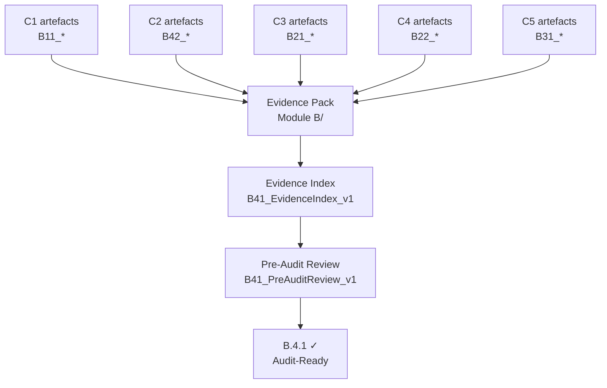

import { Aside, Steps, Badge, FileTree } from "@astrojs/starlight/components";

<Badge text="Module B.4.1" variant="note" /> <Badge text="Copilot + skill" variant="tip" />
<Badge text="~60 min" variant="default" />

## What B.4.1 requires

Control **B.4.1** is the meta-control for the entire Module B evidence pack. It validates that:

1. Every control (B.1.1, B.2.1, B.2.2, B.3.1, B.4.2) has at least one evidence artefact.
2. All artefacts use the naming convention `[ControlRef]_[DocumentType]_v[N].pdf`.
3. The folder structure follows `Module B / B[ref] /` with no artefacts in the root.
4. A dated **pre-audit review record** exists and a **single point of contact (SPOC)** is named.



### Required folder structure

<FileTree>

- Module B/
  - B.1.1/
    - B11_CaseStudy_v1.pdf
    - B11_ArchitectureDiagram_v1.pdf
  - B.2.1/
    - B21_ACRBreakdown_v1.pdf
  - B.2.2/
    - B22_CustomerList_v1.pdf
  - B.3.1/
    - B31_SkillingMapping_v1.pdf
    - B31_AZ120Transcript\_[Name]\_v1.pdf
  - B.4.1/
    - B41_EvidenceIndex_v1.pdf
    - B41_PreAuditReview_v1.pdf
  - B.4.2/
    - B42_OnboardingPack_v1.pdf

</FileTree>

### Naming convention rules

| Part             | Rule                             | Example                     |
| ---------------- | -------------------------------- | --------------------------- |
| `[ControlRef]`   | Two-digit control number, no dot | `B21`, `B31`                |
| `[DocumentType]` | PascalCase, no spaces            | `CaseStudy`, `ACRBreakdown` |
| `v[N]`           | Version integer, starts at 1     | `v1`, `v2`                  |
| Extension        | `.pdf` for submissions           | `.pdf`                      |

:::note[Trainer notes]
**Talk track (5 min before lab):** "B.4.1 is the auditor's first stop. They check the folder, the
index, then spot-check individual artefacts. A single file named `case study final FINAL.pdf` will
fail naming validation. Copilot's `build-evidence-index` skill catches those issues before the
auditor does."

**Timing note:** if C1–C5 artefacts are incomplete, trainees can use the sample artefacts in each
challenge's `evidence/` folder as placeholders. The goal here is to practice the _assembly_ and
_validation_ workflow.
:::

## Prerequisites

- [ ] C1–C5 complete (or using sample placeholder artefacts from each challenge's `evidence/` folder).
- [ ] You have the evidence files from each challenge ready to assemble.

## Learning objectives

By the end of this lab you can:

1. Create the `Module B / B[ref] /` folder structure and populate it from C1–C5 artefacts.
2. Use the `build-evidence-index` skill to generate an evidence index with one row per control.
3. Validate naming convention and completeness using Copilot.
4. Produce a pre-audit review record and appoint a SPOC.
5. Produce the `B41_EvidenceIndex_v1.pdf` and `B41_PreAuditReview_v1.pdf` artefacts.

## Lab

<Steps>

1. ### Create the evidence pack folder structure

   ```bash
   mkdir -p \
     "labs/challenge-6-audit-readiness/evidence-pack/Module B/B.1.1" \
     "labs/challenge-6-audit-readiness/evidence-pack/Module B/B.2.1" \
     "labs/challenge-6-audit-readiness/evidence-pack/Module B/B.2.2" \
     "labs/challenge-6-audit-readiness/evidence-pack/Module B/B.3.1" \
     "labs/challenge-6-audit-readiness/evidence-pack/Module B/B.4.1" \
     "labs/challenge-6-audit-readiness/evidence-pack/Module B/B.4.2"
   echo "Folder structure created."
   tree labs/challenge-6-audit-readiness/evidence-pack/
   ```

2. ### Copy or create placeholder artefacts

   Copy the evidence files produced in C1–C5 into the correct sub-folders:

   ```bash
   # B.2.1 — from C3
   cp labs/challenge-3-acr/evidence/B21_ACRBreakdown_v1.md \
     "labs/challenge-6-audit-readiness/evidence-pack/Module B/B.2.1/"

   # B.2.2 — from C4
   cp labs/challenge-4-customer-diversity/evidence/B22_CustomerList_v1.md \
     "labs/challenge-6-audit-readiness/evidence-pack/Module B/B.2.2/"

   # B.3.1 — from C5
   cp labs/challenge-5-skilling/evidence/B31_SkillingMapping_v1.md \
     "labs/challenge-6-audit-readiness/evidence-pack/Module B/B.3.1/"

   # Use sample placeholders for B.1.1 and B.4.2 if C1/C2 are not yet complete
   cp labs/challenge-6-audit-readiness/sample-data/B11_CaseStudy_placeholder.md \
     "labs/challenge-6-audit-readiness/evidence-pack/Module B/B.1.1/" 2>/dev/null || true
   ```

3. ### Generate the evidence index with `build-evidence-index`

   Open **Copilot Chat** and run the skill:

   ```
   @moduleb-lab-coach Run the build-evidence-index skill. Scan all files under
   labs/challenge-6-audit-readiness/evidence-pack/Module B/ and produce:
   1. An evidence index table (Control | ControlRef | DocumentType | FileName | Version | Status)
   2. A completeness check — flag any control with no artefact as MISSING
   3. A naming validation — flag any file that does not match [ControlRef]_[DocumentType]_v[N]
      as INVALID_NAME
   ```

   Expected output:

   | Control | File                      | Version | Status                          |
   | ------- | ------------------------- | ------- | ------------------------------- |
   | B.1.1   | B11_CaseStudy_v1.md       | 1       | ✅ VALID                        |
   | B.2.1   | B21_ACRBreakdown_v1.md    | 1       | ✅ VALID                        |
   | B.2.2   | B22_CustomerList_v1.md    | 1       | ✅ VALID                        |
   | B.3.1   | B31_SkillingMapping_v1.md | 1       | ✅ VALID                        |
   | B.4.2   | B42_OnboardingPack_v1.md  | 1       | ✅ VALID                        |
   | B.4.1   | —                         | —       | ⚠️ MISSING (will generate next) |

   :::note[Trainer notes]
   **Answer key:** the MISSING entry for B.4.1 is expected at this point — trainees generate
   those artefacts in the next two steps. If any control shows INVALID_NAME, that is a teaching
   moment: rename the file to match the convention.
   :::

4. ### Fix naming violations (if any)

   If Copilot flags any INVALID_NAME files, rename them:

   ```bash
   # Example: rename a mis-named file
   # mv "Module B/B.2.1/acr breakdown.pdf" "Module B/B.2.1/B21_ACRBreakdown_v1.pdf"

   # Re-run the validation
   # Ask Copilot again:
   # @moduleb-lab-coach Re-run the naming validation on Module B/ after the renames.
   ```

5. ### Produce the evidence index document

   Ask Copilot to format the index as a document:

   ```
   @moduleb-lab-coach Format the evidence index as a formal document with:
   - Title: "Module B Evidence Index — SAP on Microsoft Azure Advanced Specialization"
   - Date: today's date
   - Partner name: [your company name]
   - MPN ID: [your MPN ID]
   - The evidence index table
   - A declaration: "All artefacts listed above are complete and meet the naming convention."
   Save it as labs/challenge-6-audit-readiness/evidence-pack/Module B/B.4.1/B41_EvidenceIndex_v1.md
   ```

6. ### Conduct the pre-audit review

   The pre-audit review is a brief internal meeting to confirm readiness before the Microsoft
   auditor accesses the evidence pack. Use Copilot to generate the review record:

   ```
   @moduleb-lab-coach Generate a pre-audit review record for Module B with:
   - Date: today's date
   - Attendees: [your name], [SPOC name], [reviewer name]
   - SPOC (Single Point of Contact): [name, email, phone]
   - Review checklist: all controls have evidence, naming valid, index complete
   - Outcome: READY / NOT READY
   - Next steps (if NOT READY)
   Save it as labs/challenge-6-audit-readiness/evidence-pack/Module B/B.4.1/B41_PreAuditReview_v1.md
   ```

   The SPOC is the person the Microsoft auditor contacts if they have questions about specific
   evidence artefacts. In most partners this is the Practice Lead or a designated SAP on Azure
   technical lead.

7. ### Final completeness check

   ```bash
   # List all files in the evidence pack
   find "labs/challenge-6-audit-readiness/evidence-pack/Module B" -type f | sort

   # Confirm six controls all have at least one artefact
   for ctrl in B.1.1 B.2.1 B.2.2 B.3.1 B.4.1 B.4.2; do
     count=$(find "labs/challenge-6-audit-readiness/evidence-pack/Module B/$ctrl" \
       -type f 2>/dev/null | wc -l)
     echo "$ctrl: $count file(s)"
   done
   ```

   :::note[Trainer notes]
   **Expected output:** each control folder should show ≥ 1 file. B.4.1 should show 2 files
   (EvidenceIndex + PreAuditReview). If any folder shows 0, prompt trainees to revisit the
   corresponding challenge (C1–C5) and copy the missing artefact.
   :::

</Steps>

## Verification checklist

- [ ] Folder structure `Module B / B[ref] /` created with six sub-folders.
- [ ] At least one artefact in each of B.1.1, B.2.1, B.2.2, B.3.1, B.4.1, B.4.2.
- [ ] All files pass naming convention validation (`[ControlRef]_[DocumentType]_v[N]`).
- [ ] Evidence index `B41_EvidenceIndex_v1.md` generated and saved.
- [ ] Pre-audit review `B41_PreAuditReview_v1.md` generated with SPOC named.
- [ ] Final completeness check shows ≥ 1 file per control.

## Evidence produced

| Artefact                       | Naming convention           | Control satisfied |
| ------------------------------ | --------------------------- | ----------------- |
| Evidence index (all controls)  | `B41_EvidenceIndex_v1.pdf`  | B.4.1             |
| Pre-audit review record + SPOC | `B41_PreAuditReview_v1.pdf` | B.4.1             |

:::note[Trainer notes]
**Full talk track and slide deck** live in the [Facilitation Guide](/trainer-guide/facilitation/)
and `slides/`. For re-delivery: if time is tight, combine Steps 5 and 6 — Copilot can produce both
documents in a single prompt with a combined template. The folder structure and naming validation
(Steps 1–4) are non-negotiable: they are exactly what the Microsoft auditor checks first.
:::
