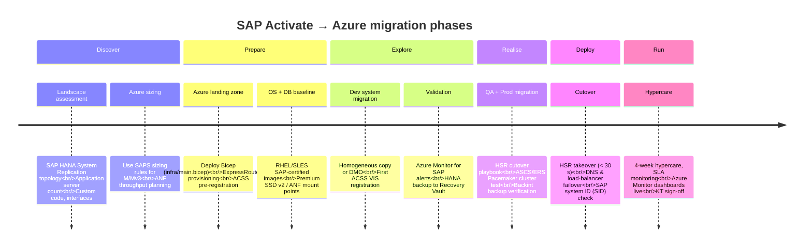

import { Aside, Steps, Badge, Card, CardGrid } from "@astrojs/starlight/components";

export const base = import.meta.env.BASE_URL;

<Badge text="Module B.4.2" variant="note" /> <Badge text="Azure-technical" variant="tip" />
<Badge text="~75 min" variant="default" />

## Learning objectives

By the end of this lab you can:

- Map **SAP Activate** phases to the **Azure migration workstream** and explain which Azure
  service is introduced at each phase.
- Register the simulated landscape with **Azure Center for SAP Solutions (ACSS)** and enable
  **Azure Monitor for SAP Solutions** and **Azure Backup for SAP HANA** via portal and CLI.
- Use the **Module B Lab Coach** Copilot skills (`generate-hld`, `generate-runbook`) to produce a
  repeatable **onboarding pack**: High-Level Design, Low-Level Design, migration runbook, Knowledge
  Transfer plan, and Hypercare plan.
- File the onboarding pack as B.4.2 evidence using the `[ControlRef]_[DocumentType]_v[N].pdf`
  naming convention.

---

## Background — B.4.2 control at a glance

Control **B.4.2** asks partners to demonstrate a **repeatable onboarding and migration methodology**
for SAP on Azure, with evidence it has been applied to a real customer engagement.

| Evidence type                | Accepted artefact                                                        |
| ---------------------------- | ------------------------------------------------------------------------ |
| Methodology documentation    | HLD + LLD (one per engagement or anonymised template)                    |
| Migration execution artefact | Runbook used during cutover (tested, timestamped steps)                  |
| Knowledge transfer           | KT plan and delivery confirmation (sign-off, recorded session)           |
| Hypercare / stabilisation    | Hypercare plan with SLA, escalation path, and exit criteria              |
| ACSS registration            | Screenshot or export of ACSS VIS (Virtual Instance for SAP) registration |

This lab produces all five using Copilot skills and guided Azure portal + CLI steps.

---

## SAP Activate → Azure phase map

The diagram below maps **SAP Activate methodology phases** to the Azure migration workstream.
Use this as the backbone of your HLD and runbook.



:::note[Trainer notes]
**Timing:** 5 min walkthrough. The mapping exercise often reveals gaps — SAP-Basis consultants
are fluent in Activate but don't always know which Azure service turns on at each phase. Pause
at **Discover** (sizing) and **Deploy** (HSR takeover) — these are where the most audit questions arise.
:::

---

## Reference service set for B.4.2

| Phase   | Azure service / feature                      | Purpose                                          |
| ------- | -------------------------------------------- | ------------------------------------------------ |
| Prepare | Azure Center for SAP Solutions (ACSS)        | Guided deployment, VIS registration, insights    |
| Prepare | Azure NetApp Files (NFS 4.1)                 | `/sapmnt`, `/usr/trans`, HANA log + data volumes |
| Realise | Azure Monitor for SAP Solutions              | HANA, OS, NetWeaver metrics + alerting           |
| Realise | Azure Backup for SAP HANA (Backint)          | Policy-based backups to Recovery Services Vault  |
| Deploy  | Availability Zones + HSR                     | Zero-downtime cutover, RPO ≈ 0                   |
| Deploy  | Azure Load Balancer (Standard SKU, HA ports) | ASCS/ERS floating IP, HANA read-scale VIP        |
| Run     | Azure Update Manager + ACSS Insights         | Patch compliance, CPU/memory trending            |

---

## Step 1 — Register with Azure Center for SAP Solutions (ACSS)

ACSS provides a single pane of glass for SAP on Azure. In this step you register a **Virtual
Instance for SAP (VIS)** representing the simulated landscape.

### 1a · Portal walkthrough

1. Open the [Azure portal](https://portal.azure.com) → search **Azure Center for SAP solutions**.
2. Select **Create a new Virtual Instance for SAP solutions**.
3. Choose **Register an existing SAP system**.
4. Fill in:
   - **Subscription** — your sandbox subscription
   - **Resource group** — `rg-sapmh-lab` (created in C1)
   - **SAP system ID (SID)** — `S4H`
   - **Environment** — Non-Production
   - **SAP product** — SAP S/4HANA 2023
5. Select the **Application server** and **HANA DB** resource groups (simulated — point to the lab RG).
6. Click **Review + create** → **Create**.

### 1b · Azure CLI equivalent

The CLI form of **Register an existing SAP system** uses `--central-server-vm-id` to point at the
ASCS/central-server VM (Discovery mode). This matches the portal flow above.

```bash
# Replace <central-server-vm-resource-id> with the ARM resource ID of your ASCS/central-server VM
# e.g. /subscriptions/<sub>/resourceGroups/rg-sapmh-lab/providers/Microsoft.Compute/virtualMachines/vm-ascs-s4h
az workloads sap-virtual-instance create \
  --resource-group rg-sapmh-lab \
  --name S4H \
  --location swedencentral \
  --environment NonProd \
  --sap-product S4HANA \
  --central-server-vm-id <central-server-vm-resource-id>
```

> **Simulated lab:** no real VM exists. Run the portal steps (1a) and capture a screenshot as your
> audit evidence. The CLI command is shown for reference and real-world use.

<Aside type="tip">
  ACSS requires the **Azure Workloads** resource provider. Register it if the CLI command fails: `az
  provider register --namespace Microsoft.Workloads --wait`
</Aside>

:::note[Trainer notes]
**Timing:** 10 min. If the landing zone from C1 doesn't have real VMs, use the portal's
**Register existing** flow and point at the lab RG — the VIS record still satisfies the audit
screenshot requirement.

**Pitfall:** ACSS is not available in every region. Sweden Central, East US, and West Europe are
safe choices. Redirect to East US if ACSS isn't available in the chosen region.
:::

---

## Step 2 — Enable Azure Monitor for SAP Solutions

Azure Monitor for SAP Solutions collects OS, HANA, NetWeaver, and Pacemaker telemetry without
requiring SAP-side agents.

### 2a · Create a Monitor resource (portal)

1. In the Azure portal, search **Azure Monitor for SAP solutions**.
2. Click **Create**.
3. Select your subscription and resource group (`rg-sapmh-lab`).
4. Choose **SAP HANA** as the first provider to add.
5. Enter the HANA host name / IP and the SYSTEMDB credential.
6. Click **Create provider** → **Review + create**.

### 2b · CLI equivalent

The `az workloads monitor` command lives in the **workloads** CLI extension. Install it once, then
create the AMS resource. `--monitor-subnet` is required — it takes the ARM resource ID of an AMS-
delegated subnet in your VNet.

```bash
# Install the workloads extension (one-time per machine / Codespace)
az extension add --name workloads

# Create the AMS resource
# Replace <ams-subnet-arm-id> with the ARM resource ID of your AMS-delegated subnet
# e.g. /subscriptions/<sub>/resourceGroups/rg-sapmh-lab/providers/Microsoft.Network/virtualNetworks/vnet-sapmh-lab/subnets/snet-ams
az workloads monitor create \
  --resource-group rg-sapmh-lab \
  --name mon-sapmh-lab \
  --location swedencentral \
  --app-location swedencentral \
  --managed-rg-name rg-sapmh-lab-managed \
  --monitor-subnet <ams-subnet-arm-id> \
  --routing-preference RouteAll \
  --identity type=None

# Add HANA provider
az workloads monitor provider-instance create \
  --monitor-name mon-sapmh-lab \
  --resource-group rg-sapmh-lab \
  --provider-instance-name hana-s4h \
  --provider-settings '{"providerType":"SapHana","hanaHostname":"10.0.1.4","hanaDbName":"SYSTEMDB","hanaDbSqlPort":30013,"hanaDbUsername":"SYSTEM","hanaDbPasswordUri":"<keyvault-secret-uri>"}'
```

<Aside type="caution">
  Never hardcode passwords in scripts. The `hanaDbPasswordUri` field takes an Azure Key Vault secret
  URI (`https://<vault>.vault.azure.net/secrets/<name>`). Retrieve it with `az keyvault secret show`
  or configure a managed-identity reference. The `<keyvault-secret-uri>` placeholder must be
  replaced before use.
</Aside>

---

## Step 3 — Enable Azure Backup for SAP HANA

Azure Backup uses the **Backint** interface certified by SAP to take consistent HANA backups.

### 3a · Create a Recovery Services Vault (portal)

1. Search **Recovery Services vaults** → **Create**.
2. Name: `rsv-sapmh-lab`, RG: `rg-sapmh-lab`, Region: Sweden Central.
3. Select **Backup** → **Configure backup**.
4. Workload: **SAP HANA in Azure VM**.
5. Discover DBs → select the simulated HANA VM → select `SYSTEMDB` + tenant DBs.
6. Apply a **Full + Log backup policy** (daily full, log every 15 min).

### 3b · CLI equivalent

```bash
# Create vault
az backup vault create \
  --name rsv-sapmh-lab \
  --resource-group rg-sapmh-lab \
  --location swedencentral

# Enable soft-delete and enhanced security
az backup vault backup-properties set \
  --name rsv-sapmh-lab \
  --resource-group rg-sapmh-lab \
  --soft-delete-feature-state Enable
```

:::note[Trainer notes]
**Timing:** Steps 1–3 together take ~20 min. Many SAP Basis consultants are unfamiliar with
Azure Backup policies; focus on the **Full + Log** combination and why log backups every 15 min
gives near-zero RPO.

**Pitfall:** Backup discovery requires a pre-registration script to run on the HANA VM. In the
simulated lab there is no real VM, so show the portal discovery flow as a screenshot walk only.
:::

---

## Step 4 — Generate the onboarding pack with Copilot

Use the Module B Lab Coach and the `generate-hld` / `generate-runbook` skills to produce the
five B.4.2 deliverables.

### 4a · High-Level Design (HLD)

```
@moduleb-lab-coach #generate-hld
Customer: ACME Manufacturing GmbH (anonymised)
Scope: SAP S/4HANA 2023 greenfield on Azure
Azure region: Sweden Central, 2 AZs
HANA: Mv3, HSR sync
App servers: 2 × Edsv5
ASCS/ERS: Pacemaker + SBD, Dsv5
Storage: Azure NetApp Files
Network: ExpressRoute + Azure Firewall
Management: ACSS, Azure Monitor for SAP, Azure Backup
Migration wave: single-wave (non-prod → prod, 14 weeks)
```

Review the output: it should cover compute, storage, network, HA/DR, and management layers.

### 4b · Low-Level Design (LLD)

```
@moduleb-lab-coach #generate-hld
mode: LLD
Expand the HLD above into a Low-Level Design. Include:
- VM SKU specifications and SAPS sizing calculation
- ANF volume layout (/sapmnt, /usr/trans, hana-data, hana-log)
- Network CIDR allocations (app tier, DB tier, management)
- HANA SID/tenant DB names and port assignments
- Azure Load Balancer rules (ASCS, ERS, HANA read-scale)
- Pacemaker resource agents and SBD device
- Backup schedule (full daily 22:00 UTC, log every 15 min)
```

### 4c · Migration runbook

```
@moduleb-lab-coach #generate-runbook
Type: cutover runbook
System: SAP S/4HANA 2023 (SID: S4H)
Approach: HSR takeover
Cutover window: Saturday 22:00 – Sunday 06:00 UTC
Steps required:
  - SAP system lock (SMICM, SM12)
  - Final HANA log backup
  - HSR secondary promotion
  - DNS failover
  - Azure Load Balancer health probe verification
  - SAP system start (HANA + ASCS + App servers)
  - Smoke test (SU01, SE16N, transaction SM21)
  - Go/no-go decision point (T+2h)
Include: estimated duration per step, rollback decision, on-call contacts template
```

### 4d · Knowledge Transfer plan

```
@moduleb-lab-coach #generate-runbook
Type: KT plan
Audience: customer Azure/SAP Basis team (3 people)
Duration: 4 sessions × 2h
Topics:
  - ACSS navigation and VIS health views
  - Azure Monitor for SAP dashboards + alert configuration
  - Azure Backup restore procedure (full + log replay)
  - Pacemaker cluster maintenance (fencing, node eviction)
  - ExpressRoute monitoring and failover test
Deliverables: recorded sessions, runbook hand-off, signed KT completion form
```

### 4e · Hypercare plan

```
@moduleb-lab-coach #generate-runbook
Type: hypercare plan
Duration: 4 weeks post-go-live
SLA: P1 = 1h response, P2 = 4h, P3 = next business day
Escalation: [Partner on-call] → [Azure SAP FastTrack] → [SAP Support]
Exit criteria:
  - Zero P1/P2 incidents in final 7 days
  - Customer self-service on ACSS and Monitor dashboards confirmed
  - KT sign-off received
  - Hypercare closeout report delivered
```

:::note[Trainer notes]
**Timing:** 20 min across all five artefacts. Encourage students to run each prompt
sequentially and refine once — the Lab Coach maintains context within a session so the LLD
references the HLD automatically.

**Pitfall:** students sometimes skip the LLD. Remind them it is a distinct audit artefact from the
HLD and must include concrete IP/sizing numbers.
:::

---

## Step 5 — File the B.4.2 evidence artefacts

Save and rename each generated document:

| Artefact                | File name example             | Folder              |
| ----------------------- | ----------------------------- | ------------------- |
| High-Level Design       | `B42_HLD_v1.pdf`              | `Module B / B4.2 /` |
| Low-Level Design        | `B42_LLD_v1.pdf`              | `Module B / B4.2 /` |
| Migration runbook       | `B42_MigrationRunbook_v1.pdf` | `Module B / B4.2 /` |
| Knowledge Transfer plan | `B42_KTPlan_v1.pdf`           | `Module B / B4.2 /` |
| Hypercare plan          | `B42_HypercarePlan_v1.pdf`    | `Module B / B4.2 /` |
| ACSS VIS screenshot     | `B42_ACSSRegistration_v1.pdf` | `Module B / B4.2 /` |

**Convention:** `[ControlRef]_[DocumentType]_v[N].pdf` — increment `vN` on each revision.

---

## Verification checklist

Run the verification script:

```bash
bash labs/challenge-2-onboarding/verify.sh
```

or on PowerShell:

```powershell
pwsh labs/challenge-2-onboarding/verify.ps1
```

Manual checks:

- [ ] ACSS VIS created (or screenshot captured) for SID `S4H`
- [ ] Azure Monitor for SAP resource created with at least one provider
- [ ] Recovery Services Vault created with backup policy configured
- [ ] Five onboarding-pack documents created and named `B42_*_v1.*`
- [ ] Runbook includes a go/no-go decision point and rollback procedure
- [ ] Hypercare plan lists exit criteria

---

:::note[Trainer notes]
**Total timing:** 75 minutes.

| Step | Activity                                 | Time   |
| ---- | ---------------------------------------- | ------ |
| 0    | B.4.2 control intro + SAP Activate map   | 10 min |
| 1    | ACSS registration (portal + CLI)         | 10 min |
| 2    | Azure Monitor for SAP enable             | 7 min  |
| 3    | Azure Backup enable                      | 8 min  |
| 4    | Onboarding pack generation (5 artefacts) | 25 min |
| 5    | File + rename evidence                   | 5 min  |
| —    | Buffer / Q&A                             | 10 min |

**Pitfalls:**

- ACSS provider registration (`Microsoft.Workloads`) can take 5–10 min — kick it off early.
- Azure Monitor for SAP requires the HANA VM to be reachable. In a fully simulated lab, walk
  through the portal steps as a screenshot demo only.
- The Backint pre-registration script (`msawb-plugin-config-com-sap-hana.sh`) must run on the
  HANA OS as root — in the simulated lab show the command only; do not execute.

**Answer key:** see `labs/challenge-2-onboarding/sample-answers/` for reference outputs.
:::
